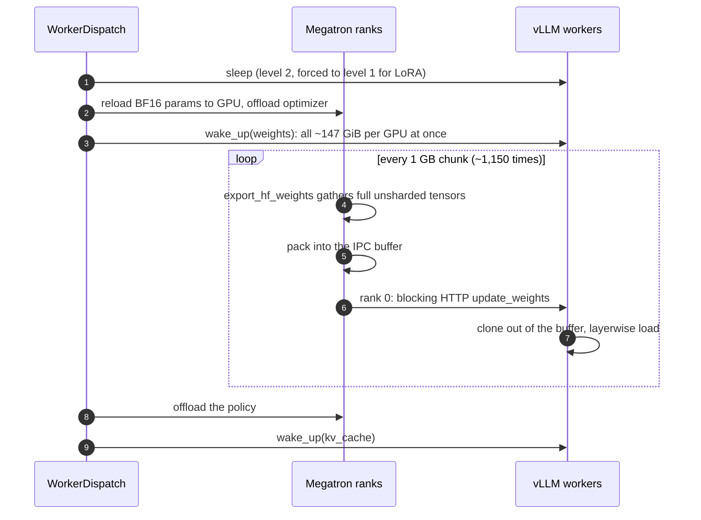
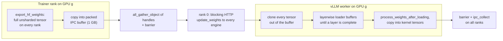
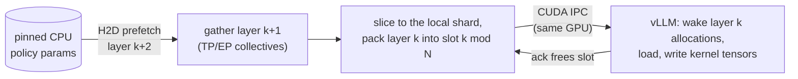
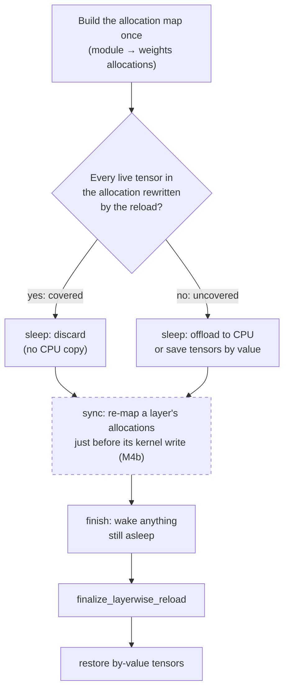
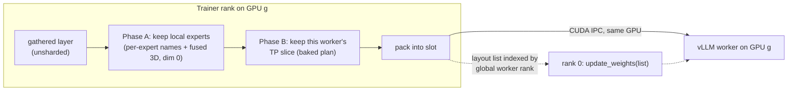
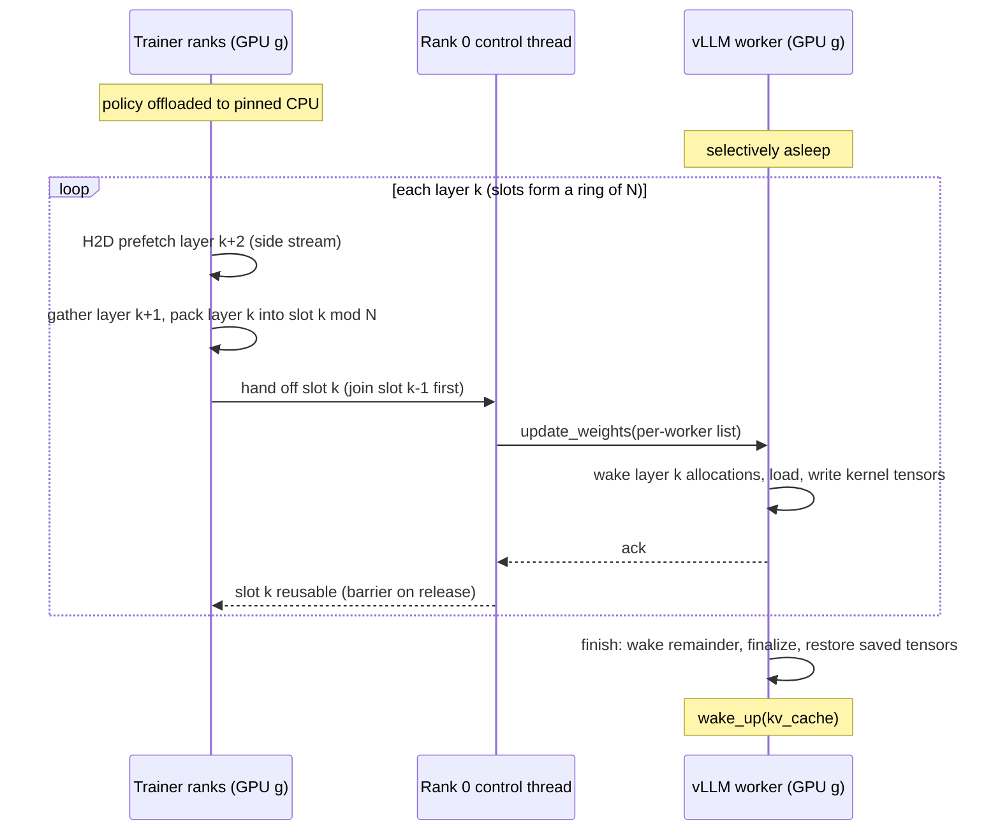
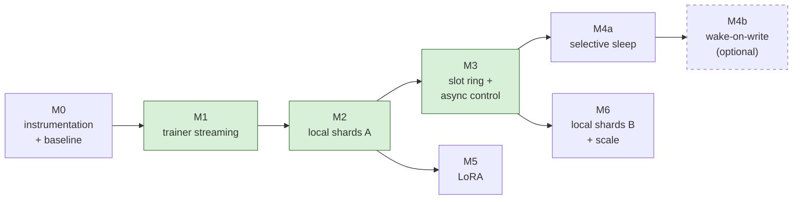

# Bounded-memory colocated weight sync

> **Status:** implemented on this branch as opt-in options; results in `colocated_weight_sync_results.md`.
> Milestone 3.1's `stream_weight_sync_from_cpu` shipped as `megatron_config.weight_sync_from_offloaded_params`
> (the export reads offloaded params from their pinned CPU copies). This branch pins `vllm==0.32.0`.
> **Scope:** `placement.colocate_all=true`, Megatron trainer, CUDA-IPC weight sync (`skyrl_ipc`),
> full-weight and LoRA-adapter (`lora.sync_mode=memory`) targets
> **vLLM pin:** `vllm==0.33.0`. Every vLLM reference was checked against `v0.32.0` and `v0.33.0`;
> differences are called out.
> **Read first:** `.agents/docs/weight_sync.md`, `.agents/docs/backends/megatron.md`,
> `.agents/docs/inference.md`

## TL;DR

When the vLLM weights fill most of a GPU, colocated weight sync either **runs out of memory** or
takes **~18 minutes**. Four changes fix it. Each can land and be measured on its own:

| # | Change | Fixes | Milestone |
|---|---|---|---|
| 1 | **Trainer streaming.** Keep the policy offloaded and stream the export from pinned CPU, one layer at a time, under a per-GPU budget | Trainer shard and transients no longer compete with the woken engine; the LoRA trainer-side OOM | M1, M5 |
| 2 | **Receiver-local shards.** Each trainer rank packs only what the vLLM worker on its own GPU serves | ~1.2 TB per worker becomes ~147 GiB; the high-rank LoRA OOM on the vLLM side | M2, M6 |
| 3 | **Pipelined slot ring.** N IPC buffers with an async control plane, chunks aligned to layers | ~1,150 serialized round trips become ~one per layer, hidden behind the next gather | M3 |
| 4 | **Staged vLLM wake.** Selective sleep (discard what the reload rewrites), then optionally wake each layer just before it is written (the final stage of [vLLM RFC #15254](https://github.com/vllm-project/vllm/issues/15254)) | Level-2 sleep that is safe by construction; no up-front ~147 GiB wake | M4a, M4b (optional) |

Priority: **M1-M3** solve both the memory problem and the 18-minute problem. **M4a** comes next.
**M4b** is last and optional. Nothing strictly needs an upstream vLLM change.

## Contents

1. [Background: what happens today](#1-background-what-happens-today)
2. [Goals and non-goals](#2-goals-and-non-goals)
3. [Design](#3-design)
   - [3.1 Trainer streaming](#31-trainer-side-streaming-export-under-a-per-gpu-budget)
   - [3.2 Staged vLLM wake](#32-vllm-side-staged-wake-up)
   - [3.3 Receiver-local shards](#33-receiver-local-shards)
   - [3.4 Pipeline and round trips](#34-pipeline-and-round-trips)
   - [3.5 Target memory timeline](#35-target-memory-timeline)
4. [Config and APIs](#4-config-and-apis)
5. [Milestones](#5-milestones)
6. [Risks and open questions](#6-risks-and-open-questions)
7. [Notes for the implementing agent](#7-notes-for-the-implementing-agent)
8. [Revision history](#8-revision-history)

---

## 1. Background: what happens today

**Motivating case.** A large MoE: ~600B parameters, ~1.2 TB of BF16 weights. It is served by TP8
vLLM engines on 8xB200 (178 GiB) nodes and colocated with Megatron (TP2 / EP32). Each vLLM
worker holds **~147 GiB** of weights. Small models never hit this. It is what limits colocation
once vLLM weights fill most of a GPU.

### 1.1 Control flow

`WorkerDispatch.save_weights_for_sampler` (`skyrl/backends/skyrl_train/workers/worker_dispatch.py`),
colocated branch:



<details>
<summary>Step-by-step detail</summary>

1. `_prepare_for_weight_sync`
   - **Full weights.** `sleep()` the engines if they are awake. Level 2 discards the weights; the
     client forces level 1 when `uses_lora_weight_sync`. Then `_ensure_on_gpu("policy",
     need_model=True, need_optimizer=False)` reloads the policy's BF16 params onto the GPU,
     offloading other colocated models. The optimizer is offloaded if `offload_after_step`. Then
     `empty_cache`.
   - **Adapter-only LoRA.** Offload every model (model and optimizer), then `empty_cache`. The
     engines were already put to sleep at level 1, so their base weights sit in pinned CPU memory.
2. `ensure_active_adapter`.
3. `wake_up(tags=["weights"])` on every engine. All `weights`-tagged CuMem allocations are
   re-mapped at once. Level 1 also copies the CPU backup back. Level 2 leaves garbage that the
   sync overwrites, with SkyRL/vLLM restoring buffers that were saved before sleep.
4. `MegatronPolicyWorker.broadcast_to_inference_engines` -> `_sync_weights_to_inference_engines`
   -> `engine.send_weights()` (packed IPC). For LoRA, `_publish_lora_adapter_in_memory` exports,
   dedupes and finalizes on the GPU, arms the receive target, and uses the same IPC round trip.
5. `_finish_weight_sync` offloads the policy model, and the optimizer if configured. It is a
   no-op for LoRA.
6. `wake_up(tags=["kv_cache"])`.

</details>

### 1.2 Anatomy of one IPC round trip

vLLM `ipc_engine.py` / `packed_tensor.py`, the same in 0.32 and 0.33:



- Every trainer rank iterates the same `MegatronWeightSource.iter_full()`. Megatron-Bridge
  `export_hf_weights` gathers each param across TP/PP/EP, so **every rank holds the full,
  unsharded HF tensor**.
- `packed_ipc_producer` copies tensors into one reusable buffer of size
  `generator.inference_engine.weight_transfer_threshold_cuda_ipc_GB` (default 1.0, floored at the
  largest param by `weight_senders._packed_buffer_size_bytes`).
- The receiver (`packed_ipc_consumer`) **clones every tensor** out of the buffer belonging to the
  trainer rank on its own GPU, then calls `model.load_weights`. Under layerwise reload
  (`start_weight_update` -> `initialize_layerwise_reload`), the loader **buffers** the clones per
  layer until the layer's numel is complete. It then materializes a temporary layer, runs
  `process_weights_after_loading`, and copies into the original ("kernel") tensors.

> [!IMPORTANT]
> Every worker receives the **whole unsharded model** (~1.2 TB here) and slices out its shard in
> the loader. Each chunk exists **twice** on a GPU (the sender's buffer and the receiver's clones),
> plus up to one layer of buffered unsharded tensors on the receiver.

### 1.3 What we observed

| Case | Symptom | Cause |
|---|---|---|
| Full weights, 1 GB buffer | Sync takes **~18 min** (vs ~60-80 s for the non-colocated NCCL broadcast over IB) | ~1.2 TB per worker / 1 GB = **~1,150 serialized round trips** |
| Full weights, 3 or 8 GB buffer | OOM | The engine is fully woken (~147 GiB/GPU) while the trainer buffer, receiver clones and layerwise-buffered tensors share the GPU |
| Full weights, any buffer | Trainer shard does not fit | The reloaded BF16 shard (tens of GiB at TP2/EP32) sits next to the woken weights |
| LoRA rank 32 (~86M params) | Trainer-side OOM in `broadcast_to_inference_engines`: *"Tried to allocate 15.19 GiB ... 11.48 GiB is free. Process ... has 143.79 GiB memory in use"* | A sender-side transient: export / dedupe / 3D-to-flat rewrite materializes the whole adapter on the GPU |
| LoRA rank 64-256 | vLLM-side OOM in `update_weights` | Fused 3D expert adapters (`[num_experts, r, in]` per layer) go whole to every TP rank, though each serves only its local experts under vLLM EP. `dedupe_shared_expert_adapters` only dedupes per-expert keys |

### 1.4 Per-GPU memory today

Full weights, motivating case, approximate. One block ≈ 4.5 GiB; `|` marks capacity.
Legend: `█` trainer, `▓` vLLM weights, `▒` transfer buffers and transients, `░` KV cache.

```text
                       0                   89                  178 GiB (capacity)
                       |                   |                   |
after optimizer step   ████████                                        trainer params (+ optimizer unless offloaded)
prepare (reload)       ████████                                        ~37 GiB BF16 shard
wake_up(weights)       ████████▓▓▓▓▓▓▓▓▓▓▓▓▓▓▓▓▓▓▓▓▓▓▓▓▓▓▓▓▓▓▓▓|▓      ~184 GiB  ✗ over capacity
transfer               ████████▓▓▓▓▓▓▓▓▓▓▓▓▓▓▓▓▓▓▓▓▓▓▓▓▓▓▓▓▓▓▓▓|▓▒▒▒   + sender buffer, receiver clones, one layer
finish (offload)       ▓▓▓▓▓▓▓▓▓▓▓▓▓▓▓▓▓▓▓▓▓▓▓▓▓▓▓▓▓▓▓▓▓               ~147 GiB
wake_up(kv_cache)      ▓▓▓▓▓▓▓▓▓▓▓▓▓▓▓▓▓▓▓▓▓▓▓▓▓▓▓▓▓▓▓▓▓░░░░░░         KV pool fills the rest
```

### 1.5 Prior art

- **CPU-slice export prototype** (not public; re-implement). `offload_megatron_model_to_cpu`
  offloads DDP buffers with `buffer.offload_to_cpu(move_params=True)`: the data is kept in
  `buffer.param_data_cpu`, and the params stay views of the emptied GPU storage. A context manager
  swaps `megatron.bridge.models.conversion.model_bridge._gather_gtp_weight` (present at the pinned
  bridge revision) for one that returns `param_data_cpu[start:end].view(shape).to(param.device)`
  via `buffer.param_index_map`. Export then needs one param on the GPU at a time, and dispatch
  skips the reload. The round trips and the full vLLM wake remain.
- **[vLLM RFC #15254](https://github.com/vllm-project/vllm/issues/15254).** Stage 1 shipped as
  `wake_up(tags=...)`. The final stage, `wake_up_with_weights(new_weights_generator)`, interleaves
  *re-map, copy the new weights in, free the incoming copy*. It was never built, and the issue was
  closed as stale. The maintainers' objection: `CuMemAllocator` knows allocations, not tensors,
  and one allocation can back several tensors. The thread also notes that level 2 discards
  buffers such as rotary caches unless they are saved and restored, and that peak memory matters
  when several processes share a GPU.
- **`sharded_rdt`** (this repo). Per-layer gather groups, a ring of K slots, credit-based pacing
  (`gather_lookahead + 1` groups resident), and a pull plan baked by driving `load_weights` with
  fake tensors. This is the pattern for local-shard planning.
- **vLLM `nccl_m2n`** (`m2n_layout.py`: per-param TP placement, "direct" vs "fallback"). It is not
  usable colocated, since one NCCL communicator cannot hold two ranks per GPU. Also
  **`ep_weight_filter.py`** (0.33: local expert ids per EP rank). Both are reusable for 3.3.

---

## 2. Goals and non-goals

| | |
|---|---|
| **G1** | Trainer GPU use during sync ≈ one layer + transfer slots, independent of model size, for full weights and LoRA |
| **G2** | vLLM wakes weights per layer as the update arrives |
| **G3** | Each worker receives only its local shard |
| **G4** | Far fewer, pipelined round trips: target **< 2 min** for the motivating case |
| *Non-goals (for now)* | FSDP, serialized-FP8 sync, the MTP draft session, `sharded_rdt` / `delta`, non-colocated sync. These fall back to today's path. |

---

## 3. Design

The target pipeline, per GPU. Every stage overlaps with the next layer's work:



### 3.1 Trainer side: streaming export under a per-GPU budget

**Residency.** With streaming on, `_prepare_for_weight_sync` no longer calls
`_ensure_on_gpu(need_model=True)`. Instead it requires the policy model to be **offloaded** (DDP
param buffers in pinned CPU, fresh after the optimizer step) and the optimizer offloaded.
`_finish_weight_sync` becomes a no-op for the model. `sync_params_for_export` needs the params on
the GPU when `overlap_param_gather` is on, so run it before the post-step offload, not inside the
broadcast.

**Streaming source.** Either an option on `MegatronWeightSource` or a sibling
`MegatronStreamingWeightSource` in `sources.py`:

- Keep **one** `export_hf_weights` call: grouped expert exports must share a call (see the
  `MegatronWeightSource` docstring). The source orders tasks layer-major and drives prefetch from
  the task stream, using the layer index as in `layerwise_groups`.
- Per layer k: H2D-copy the layer's param slices from the pinned CPU buffer into a small staging
  pool on a side stream. With prefetch depth `P` (default 1), layer k+1 copies while layer k
  gathers. Gather through the bridge (TP all-gather, EP all-gather of the grouped expert tensors),
  yield, and drop the staged slice and gathered tensors as soon as they are packed.
- Implement the read as the prototype's `_gather_gtp_weight` hook first, since it is the smallest
  change. Then replace per-param H2D with per-layer prefetch for overlap.
- `metadata` (the dry export) must use the same CPU path, or derive shapes from the conversion
  tasks and checkpoint headers (`weight_sync/checkpoint_shapes.py`) without materializing. It is
  computed once and cached; keep it that way.

**Budget.** `generator.inference_engine.weight_sync_gpu_budget_GB` is the per-GPU trainer budget:

```text
budget  =  P × largest staged layer slice
        +  largest single gathered tensor        ← usually the biggest term
        +  N × slot size
```

`build_trainer_engine` derives the slot size from the budget and the checkpoint shapes (like
`_packed_buffer_size_bytes`), and fails fast, naming the term that does not fit.

> [!WARNING]
> **The gather transient exists whether or not the trainer is offloaded.** `export_hf_weights`
> materializes each HF tensor *unsharded* on every trainer rank, so a fused 3D expert tensor is
> gathered whole. In the motivating case that is 384 experts × 4608 × 4608 × 2 B ≈ **16 GB** for
> one `gate_up` tensor, held at the end of the sync next to ~147 GiB of woken vLLM weights. Size
> the budget from the largest single gathered tensor (from checkpoint shapes), not from the
> trainer's per-rank shard. Local shards (3.3) shrink what is *packed*, not what is *gathered*.
> Only an owner-to-consumer reshard (risk 5), or exporting fused experts in EP-local pieces,
> bounds the gather itself.

**LoRA.** Adapter params live in DDP buffers that stay resident (`offload_megatron_model_to_cpu`
skips them when `is_lora`). The fix is to stop materializing the whole adapter on the GPU.
`MegatronLoraAdapterSource.prepare()` streams `export_adapter_weights` per layer, applies dedupe,
the rank fold, the alpha fold and the 3D-to-flat rewrite per layer, and parks the finalized
tensors in pinned CPU. They are prepared up front because both channels need them. `iter_full()`
then streams them from CPU into a slot. The GPU bound is one layer's gathered adapter plus the
slots. Each fused 3D expert adapter is sliced per receiver (3.3) instead of being sent whole.

<details>
<summary><b>Alternative considered: keep the trainer resident and free it layer by layer</b></summary>

Instead of offloading the policy before the sync and reading it back from pinned CPU: keep the
BF16 shard on the GPU, offload (D2H) and free layer k right after it is sent, and have vLLM wake
layer k just before writing it (3.2).

**Memory works out.** Per GPU, `trainer(layers k..L) + vLLM(layers 0..k) ≈ 37·(1 − k/L) +
147·(k/L)` GiB plus transients. That is a steady ramp from the trainer shard to W, so the peak
(W + transients, at the end) is the same as in the offloaded design. It saves one H2D read of
the shard.

**Not chosen, because:**

- **Megatron cannot free part of a buffer.** At the pinned megatron-core, each DDP
  `_ParamAndGradBuffer` allocates `param_data` as one flat tensor: one per dtype group, plus one
  for expert-parallel params. Every param and bucket is a view into it, and
  `offload_to_cpu(move_params=True)` frees it as a whole (`storage().resize_(0)`). Dropping views
  frees nothing. Per-layer freeing would need per-bucket storage in Megatron DDP (touching grad
  reduce, the distributed optimizer and NCCL buffer registration), or VMM-backed trainer buffers
  that can unmap sub-ranges. Both are larger and riskier than the CPU read.
- **It makes wake-on-write (M4b) mandatory.** The ramp only fits if vLLM wakes per layer. With
  the trainer offloaded, a full `wake_up(["weights"])` already fits, so M4b stays optional. M4b is
  the most version-coupled piece (allocator internals, free-while-asleep, direct reload).
- **The CPU path is cheap.** The shard has to reach CPU before generation anyway.
  Offload-then-read adds one H2D of the shard: ~37 GiB per GPU in the motivating case, ~1 s per
  GPU at PCIe 5 rates, a few seconds with 8 GPUs sharing host links. That is against a sync
  measured in minutes.

**Revisit** if Megatron gains per-bucket or VMM-backed param storage, or if M0 shows the H2D
read-back on the critical path.

</details>

### 3.2 vLLM side: staged wake-up

This is the RFC's final stage, built on hooks vLLM already has, so no tensor-aware allocator is
needed. It splits into two parts that land separately:

- **Selective sleep (M4a)** is a correctness improvement that is worth having on its own.
- **Wake-on-write (M4b)** is optional; see [what it buys](#what-staged-wake-buys).



<details>
<summary><b>What vLLM 0.32 / 0.33 already provides</b></summary>

| Piece | Behavior |
|---|---|
| `CuMemAllocator.sleep(offload_tags)` / `wake_up(tags)` / `discard(tags)` | Tag granularity only. `DEFERRABLE_TAGS = ("weights", "kv_cache")`; every other tag (`runtime`, `cudagraph`, `default`) is always woken. `pointer_to_data: dict[ptr, AllocationData(handle, tag, cpu_backup_tensor, is_asleep)]`; module-level `create_and_map(handle)` / `unmap_and_release(handle)`. Re-mapping keeps the virtual address, so CUDA graphs and `kernel_tensors` references stay valid. |
| `CuMemBackend.suspend(level)` | Level 1 offloads `weights`, level 2 discards them; `runtime` / `cudagraph` are always offloaded. `GPUWorker.sleep(level=2)` saves `named_buffers` to CPU and restores them on wake. Backends are pluggable (`model_config.sleep_mode_backend`). |
| Model load | Runs under `use_memory_pool(tag="weights")` with `max_split_size_mb=20`, so any tensor > 20 MiB has its own (non-split) allocation. Small tensors share 2/20 MiB segments that may span layers. |
| LoRA slots | In the `runtime` pool on 0.33 (survive level 2, always woken); in the `weights` pool on 0.32. |
| Layerwise reload (`model_executor/model_loader/reload/layerwise.py`) | Kernel tensors are first written in `_copy_and_restore_kernel_tensors` (end of `_layerwise_process`), and in `finalize_layerwise_processing` for deferred attention layers, layers with no loaded weights (`_place_kernel_tensors` fallback) and partially loaded (padded) layers. |
| `GPUWorker.update_weights(update_info: dict \| list[dict])` | A list is indexed by global worker rank, so per-worker payloads are already supported (0.32 and 0.33). |
| **Missing** | Any per-allocation or per-layer wake, or a "wake with weights" API. |

</details>

**Mechanism.** It is SkyRL-local, in the worker extension and the receive engine.

1. **Allocation map**, built once at the first `init_weight_transfer_engine`. For each module
   with layerwise info, record the `weights` allocations its kernel params and buffers overlap
   (address ranges in `pointer_to_data`).
   - An allocation is **covered** iff every live tensor in it is written by
     `_copy_and_restore_kernel_tensors` during a reload. That means every kernel parameter, and
     every kernel buffer except non-persistent buffers that are not loaded (the function's own
     skip rule).
   - Padded or partially loaded params are covered: `copy_` from the temporary layer overwrites
     the whole kernel tensor, padding included, exactly as today's full-wake path does.
   - Everything else is **uncovered**: non-persistent buffers such as rotary caches, tensors of
     modules without layerwise info, MoE kernel constants.
2. **Selective sleep.** Extend `skyrl_sleep_for_weight_sync`, still driven over `/collective_rpc`.
   Discard covered allocations, and offload uncovered ones to CPU (or save the uncovered tensors
   by value, generalizing today's `_skyrl_saved_buffers`). This is *level 2 done correctly*: no
   full CPU backup, and nothing the reload does not rewrite is lost. It also subsumes the
   MoE-kernel-constant restore in `SkyrlReceiveLifecycleMixin.finish_weight_update`.
3. **Wake on write.** Replace the **module attribute**
   `layerwise._copy_and_restore_kernel_tensors`, so that a layer's still-asleep allocations are
   `create_and_map`-ed (and restored from CPU if backed up) before its kernel tensors are written.
   - Patch the module attribute, not `_layerwise_process`. Upstream's `_layerwise_process` and
     `_reload_attention_scales` both call it through the module global, and so does SkyRL's eager
     patch (`patch_layerwise_reload_eager.py`, whose `_finish` calls
     `layerwise._copy_and_restore_kernel_tensors`). One wrapper covers all three paths. (Verified
     on v0.33.0 and vLLM main 518c624a.)
   - Shared small segments wake with the first layer that touches them; later layers overwrite
     their part.
   - Call `create_and_map` (plus the CPU-restore copy) directly.

   > [!CAUTION]
   > Never call `CuMemAllocator.wake_up()` per layer or per group: it runs `gc.collect()` and
   > `empty_cache()` on every call.

   **Grouped wake.** Pack wakes the way the transfer packs tensors. The per-layer hook above is
   the correctness safety net; the normal path wakes per **group**, ahead of the load. With the
   layer-aligned chunks of 3.4, the receive engine's `update_weights` takes the layer indices named
   in the chunk (`model.layers.<N>.` prefix; embeddings, `lm_head` and the final norm go to a
   catch-all group), and wakes the union of their allocations in one pass before `load_weights`.
   One transfer slot then means one wake group. If chunks are not layer-aligned, or the source is
   out of order, the hook can instead wake ahead: layers k..k+G-1 up to
   `staged_weight_wake_group_GB`. Groups matter little at level 2 (the cost should scale with bytes
   mapped, not call count; measure it in M0). They matter at level 1, where they mean fewer,
   larger pinned H2D copies issued async on a side stream ahead of the load.
4. **Finish.** First wake anything still asleep in `weights` (normally nothing), then run the
   existing finalize, then restore the by-value tensors. **This order is load-bearing.** In
   `_finalize_attention_layer`, a deferred attention layer with no loaded weights goes through
   `_place_kernel_tensors` and then `layer.process_weights_after_loading()` directly on the kernel
   tensors, without passing through `_copy_and_restore_kernel_tensors`. The hook never sees it.
5. **Free-while-asleep guard (CUDA).** `CuMemAllocator._python_free_callback` skips unmap/release
   for asleep allocations **only on ROCm** (v0.33.0 `cumem.py:211`, same on main). On CUDA,
   freeing an asleep allocation calls `cuMemUnmap` on an unmapped range: the double-free class of
   vllm#36651. Today every allocation is woken before anything can free it. With staged wake, any
   path that drops a kernel tensor mid-sync crashes, for example a model patch or a
   `process_weights_after_loading` that swaps in a new Parameter. Patch the callback in SkyRL to
   return an empty / no-op handle for asleep allocations on CUDA too, mirroring the ROCm branch.
   Cover it with a unit test that frees a tensor while asleep.
6. **Dispatch** drops the up-front `wake_up(["weights"])`: trainer offloaded -> engines
   selectively asleep -> sync (weights wake per group or layer) -> `wake_up(["kv_cache"])`.

**Full weights vs LoRA.**

| | Sleep | During sync | Status |
|---|---|---|---|
| **Full weights** | Selective level 2 | Woken bytes grow from ~0 to W. Nothing is copied H2D except uncovered tensors. | M4a, M4b |
| **LoRA** | Level 1 (the base must come back) | Staged wake = *staged restore*: map + H2D layer by layer on a side stream, overlapped with the adapter transfer. The adapter is staged separately and activated after the restore. LoRA slots must sit outside `weights` (true on 0.33). | **Deprioritized** |

Why staged restore is deprioritized: the adapter transfer is small, so there is little to overlap
~147 GiB of H2D with, and the base must be fully restored before generation anyway. The observed
LoRA OOMs (1.3) are a trainer-side transient and whole-fused-expert sends, which 3.1 and 3.3 fix.
Build staged restore only if M0/M5 numbers show the restore on the critical path, and then with
budget-sized groups (step 3), not single layers.

#### What staged wake buys

With 3.1 alone, a full wake plus a bounded trainer already fits. Staged wake adds:

- (a) no up-front ~147 GiB map, and at level 1 no H2D copy of weights that are about to be
  overwritten;
- (b) level 2 that is safe by construction instead of by buffer save-lists;
- (c) headroom early in the sync that a budget can use;
- (d) the hook an RFC-style upstream API needs.

It does **not** lower peak memory once 3.1 lands: the peak is W + budget at the end of the sync
either way (3.5). Without 3.1 it does not help either, since the trainer's resident shard is still
on the GPU when the last layer wakes (unless the trainer frees per layer; see the alternative in
3.1). So **(b), selective sleep, is the part worth landing on its own (M4a)**. Wake-on-write (M4b)
is optional.

### 3.3 Receiver-local shards

Config: `weight_sync_local_shard`. Each trainer rank packs only what the vLLM worker on its own
GPU needs. Handles are already per GPU UUID; only the per-chunk *layout* has to become per worker.



- **Phase A: expert filter** (most of the bytes). For each vLLM worker, compute its local expert
  ids from vLLM's EP placement (mirror `ep_weight_filter.compute_local_expert_ids`).
  - Per-expert names (`.experts.<id>.`) go only to the owner.
  - Fused 3D expert tensors (base and LoRA `[E, ...]`) are sliced along dim 0 to the local experts.
    Whether the vLLM loader expects them re-indexed to local order depends on the model; verify it.
  - Everything else is sent whole.
  - Layerwise completion still works: the loader already skips non-local expert loads, so
    `load_numel_total` is already local.
- **Phase B: TP slices.** For TP-sharded params (and TP-sharded experts when vLLM does not use EP),
  bake a per-worker slice plan once at init. Drive `load_weights` with placeholder tensors that
  record which slice of each HF tensor the worker reads (`sharded_rdt`'s `FakeRDTTensor` bake, and
  `m2n_layout` for the direct cases), then pack only those slices.
- **Wire.**
  - Chunk boundaries become layer-aligned and identical in count across ranks; empty chunks are
    allowed.
  - Each rank's chunk layout (names, shapes, sizes, slice ids) is all-gathered with the handles.
    One `all_gather_object` already happens per chunk.
  - Rank 0 sends `update_weights` with a **list** indexed by global worker rank, which `GPUWorker`
    already routes. Map trainer rank -> worker rank by GPU UUID.
  - A worker whose GPU hosts no trainer rank gets the full layout from rank 0's buffer, as today.
- **Effect.** Per-worker IPC bytes drop from ~1.2 TB (unsharded) to ~147 GiB (local) after
  Phase B. Most of that comes in Phase A when experts are EP-served. Receiver clones and layerwise
  buffering shrink with it. This fixes the high-rank LoRA OOM.

### 3.4 Pipeline and round trips



- **Slot ring.** `N` IPC buffers in a ring (2 when pipelining). SkyRL overrides `_send_packed` in
  `SkyrlIPCTrainerWeightTransferEngine`. Rank 0 runs the blocking `update_weights` for slot k on a
  helper thread while all ranks gather and pack k+1 into the next slot. It joins k before posting
  k+1, so each worker still sees one update at a time, with no reliance on server-side request
  ordering. Ranks barrier once per slot release.
- **Receiver.** One `PackedBufferImporter` per slot; close all of them at finish
  (`skyrl_release_receive_buffers`).
- **Round trips.** About (local bytes / slot size). With layer-aligned chunks that is about one per
  layer: **~60-100 for the motivating case instead of ~1,150**, with their latency hidden behind the
  next layer's gather. The floor becomes the trainer's EP gather bandwidth.
- **Later** (risk 5): an all-to-all that ships each owner's slice directly, instead of
  all-gather-then-slice, cuts the gather volume by ~TP too.

### 3.5 Target memory timeline

Full weights, per GPU, with 3.1-3.4 (and optionally M4b). Same legend as 1.4.

```text
                       0                   89                  178 GiB (capacity)
                       |                   |                   |
prepare                ·                                               trainer offloaded, engine selectively asleep
sync, 1/4 of layers    ▓▓▓▓▓▓▓▓▒▒▒▒                                    woken vLLM layers + trainer budget
sync, 2/4 of layers    ▓▓▓▓▓▓▓▓▓▓▓▓▓▓▓▓▓▒▒▒▒
sync, 3/4 of layers    ▓▓▓▓▓▓▓▓▓▓▓▓▓▓▓▓▓▓▓▓▓▓▓▓▓▒▒▒▒
end of sync            ▓▓▓▓▓▓▓▓▓▓▓▓▓▓▓▓▓▓▓▓▓▓▓▓▓▓▓▓▓▓▓▓▓▒▒▒▒           peak = W + budget + one layer's receive transient
wake_up(kv_cache)      ▓▓▓▓▓▓▓▓▓▓▓▓▓▓▓▓▓▓▓▓▓▓▓▓▓▓▓▓▓▓▓▓▓░░░░░░         slots freed, KV pool fills the rest
```

Without M4b, the ramp is replaced by a single step to ~147 GiB at the start of the sync. That fits
once 3.1 holds the trainer to its budget, and has the same peak.

---

## 4. Config and APIs

All new fields default to off. `validate_inference_engine_cfg` / `validate_cfg` **reject**
unsupported combinations (non-colocated, FSDP, FP8 serialized sync, the draft session,
`sharded_rdt` / `delta`) rather than silently ignoring them.

| Field | Default | Meaning |
|---|---|---|
| `trainer.policy.megatron_config.weight_sync_from_offloaded_params` (proposed as `stream_weight_sync_from_cpu`) | `false` | 3.1: keep the policy offloaded and stream the export from pinned CPU |
| `generator.inference_engine.weight_sync_gpu_budget_GB` | `null` | Per-GPU trainer budget; derives the slot size. `null` keeps today's sizing from `weight_transfer_threshold_cuda_ipc_GB` |
| `generator.inference_engine.weight_sync_num_ipc_buffers` | `1` | Ring depth N; `2` enables the 3.4 pipeline |
| `generator.inference_engine.weight_sync_local_shard` | `false` | 3.3: Phase A, later Phase B |
| `generator.inference_engine.staged_weight_wake` | `false` | 3.2: selective sleep + wake-on-write; requires `colocate_all` |
| `generator.inference_engine.staged_weight_wake_group_GB` | `null` | 3.2 step 3: wake-ahead group size when chunks are not layer-aligned. `null` wakes per transfer chunk if layer-aligned, else per layer |

`weight_transfer_threshold_cuda_ipc_GB` keeps its meaning when the budget is unset.

**New RPCs and handshake.**

- Worker extension RPCs: `skyrl_build_weight_alloc_map`, and an extended
  `skyrl_sleep_for_weight_sync(mode="selective")`.
- The wake hook is installed by the receive engine at `start_weight_update` and removed at finish.
- The `skyrl_ipc` init info gains `num_buffers` and `local_shard`. Both sides read them at the
  handshake, so they cannot disagree.

**Fallbacks.** If a precondition fails at runtime (the allocation map cannot classify a tensor,
the model is not offloaded, the expert placement is unknown), log once and take today's path for
that sync: full `wake_up(["weights"])`, full tensors, one buffer. There is never a silent partial
wake: finish always wakes the remainder before `finalize_layerwise_reload`.

> [!WARNING]
> **Direct reload mode.** vLLM after 0.33 adds `VLLM_RELOAD_MODE=direct`
> (`model_executor/model_loader/reload/direct.py`; not in v0.33.0, present on main 518c624a).
> Loaders write the checkpoint straight into kernel storage, and there is no
> `_copy_and_restore_kernel_tensors` step to hook. `staged_weight_wake` must reject it in config
> validation (or, later, wake per parameter by wrapping the loaders). Re-check this on every vLLM
> bump.

**Upstream vLLM vs SkyRL-local.**

| Piece | Where | Notes |
|---|---|---|
| Streaming source, budget, LoRA streaming | SkyRL | The Megatron-Bridge hook `_gather_gtp_weight` is private; upstream a "param reader" hook to Megatron-Bridge eventually |
| Ring of IPC slots, async rank-0 control, per-worker layouts | SkyRL (subclass `IPCTrainerWeightTransferEngine` / `IPCWeightTransferEngine`) | Uses the existing `update_weights(list)` routing. Upstream a `num_buffers` + per-worker layout option to `packed_ipc_producer` later |
| Allocation map, selective sleep, wake-on-write | SkyRL (worker extension + layerwise-reload patch) | Touches `CuMemAllocator` internals (`pointer_to_data`, `create_and_map`, `unmap_and_release`) and private layerwise functions. Version-coupled, like the existing KV-offload path |
| Clean upstream API (recommended, not required) | vLLM | (1) `CuMemAllocator.wake_up_ranges([(ptr, nbytes), ...])` (batched, no per-call `gc.collect` / `empty_cache`) and `sleep(..., discard_ranges=...)`, or a tensor-to-allocation query, plus the CUDA free-while-asleep fix. (2) A layerwise-reload "before kernel write" callback. (3) A `sleep(level=2)` that keeps uncovered tensors automatically. (4) The RFC's `wake_up_with_weights(generator)`, built on (1) and (2). |

Nothing strictly requires an upstream change. Upstreaming (1)-(3) removes the monkeypatches.

---

## 5. Milestones

Implement in order; each milestone lands with its tests.



**Test setup.**

- **Models.** `Qwen/Qwen3-30B-A3B` (128 experts, 48 layers), and the tiny MoE from
  `gpu_ci/megatron/megatron_tiny_models/create_qwen3_moe_tiny.py` for fast iteration.
- **Topologies.** One node with Megatron TP2/EP8 and vLLM TP8 x1 and TP4 x2, with vLLM
  `enable_expert_parallel` on and off. Then 2 nodes with EP16.
- **Reproducing OOM-shaped bugs on a small model.** Add a test-only per-GPU cap
  (`torch.cuda.set_per_process_memory_fraction` in both processes) that mimics "weights ≈ GPU".

> [!NOTE]
> **Correctness gate (every milestone).** Colocated logprob parity after sync:
> `gpu_ci/megatron/test_megatron_models.py::test_logprobs_matching_roundtrip` (add a colocated
> Qwen3-30B-A3B row per flag) and
> `test_megatron_lora_models.py::test_lora_logprobs_matching_roundtrip`. Also
> `test_megatron_weight_source.py`, `gpu_ci/test_save_weights_for_sampler.py`,
> `gpu_ci/test_lora.py -k megatron_adapter`, and two syncs with a training step between them.
> (`gpu_ci/` = `tests/backends/skyrl_train/gpu/gpu_ci/`.)
>
> **Measurement (every milestone).** Per phase (prepare, wake, transfer, KV wake) and per GPU:
> - trainer `max_memory_allocated` / `reserved`, reset per phase;
> - vLLM `CuMemAllocator.get_current_usage()` + `max_memory_allocated`, via a worker-extension RPC;
> - device `torch.cuda.mem_get_info`, the true shared headroom.
>
> Wall time: split `timing/sync_weights_only_transfer` into export/gather, pack, round trips
> (count and mean latency), and receive/load. Log one JSON line per sync on rank 0.

| Milestone | What | Tests and exit criteria |
|---|---|---|
| **M0** · instrumentation + baseline | The measurements above, behind a debug flag. Baseline today's path at 1/2/4 GB buffers, confirming the clone and layerwise costs of 1.2. A micro-benchmark on B200 inside a vLLM worker: time `create_and_map` for 1, 10 and 100 allocations at realistic weight sizes, with and without the CPU-restore copy. Dump the layer -> allocation map for the target model after load (allocations per layer, bytes in segments shared across layers). | Numbers that decide whether grouped wake (3.2 step 3) beats the per-layer hook, and that size risk 1 |
| **M1** · trainer streaming (full weights) | `stream_weight_sync_from_cpu`, the dispatch residency change and the `_gather_gtp_weight` hook, then per-layer prefetch | Parity gate. Trainer peak during transfer ≤ budget, independent of model size (compare tiny vs 30B). Metadata identical to the non-streaming source: a CPU unit test in `tests/backends/skyrl_train/weight_sync/test_sources.py` against a fake bridge |
| **M2** · local shards, Phase A | Per-worker layouts via `update_weights(list)`; expert filter for per-expert and fused 3D names | CPU unit tests for the plan (expert ids, slicing, layer-aligned chunk counts equal across ranks), next to `test_weight_senders.py`. GPU parity with vLLM EP on and off. Bytes received per worker == expected local bytes (assert from the M0 counters) |
| **M3** · slot ring + async control plane | N-slot ring, rank-0 helper thread, per-slot importers | Parity. An artificially slow receiver (test-only hook) proves no slot is overwritten before its ack. Wall time vs M2 |
| **M4a** · selective sleep | Allocation map + covered/uncovered classification + selective sleep, keeping today's full `wake_up(["weights"])`. Replaces the buffer save-lists. Lands on its own | GPU unit test on the tiny MoE: byte-for-byte compare of a full-backup wake vs selective sleep + sync (risk 1). Parity gate. Re-run `gpu_ci/test_offload_kv_weight_sync.py` (it shares `skyrl_sleep_for_weight_sync`) |
| **M4b** · wake-on-write *(optional)* | Module-attribute hook on `_copy_and_restore_kernel_tensors`, grouped per-chunk wake, the CUDA free-while-asleep guard, finish-wakes-all ordering, dispatch ordering, direct-reload rejection | Build the map, sleep, sync, then assert all `weights` allocations are awake and outputs equal a fresh engine. Run with CUDA graphs on (`enforce_eager=false`) to prove address stability. Run with and without `SKYRL_VLLM_EAGER_LAYERWISE_RELOAD` (both paths must hit the hook). A free-while-asleep unit test. The memory timeline shows vLLM usage ramping during the transfer, not stepping at the wake |
| **M5** · LoRA | Streaming adapter prepare to pinned CPU; per-receiver fused-expert slicing. Staged base restore only if M0 puts the level-1 restore on the critical path (3.2) | LoRA parity gate at ranks 32 and 128 on Qwen3-30B-A3B with vLLM EP. Trainer and vLLM peaks. Extend `test_lora_target.py` / `test_lora_receive.py` for sliced fused experts |
| **M6** · local shards, Phase B + scale | Baked TP slice plan; 2-node validation | Propose default flips with numbers; update `.agents/docs/weight_sync.md` |

---

## 6. Risks and open questions

| # | Risk | Impact | Mitigation |
|---|---|---|---|
| 1 | **Allocation sharing.** Small tensors share segments across layers | Discarding a segment that holds a tensor the reload does not rewrite corrupts it | Safe only if every tensor in a discarded allocation is rewritten. Validate the coverage rule with a byte-for-byte compare of a full-backup wake vs a selective wake on the tiny model (M4a) |
| 2 | **Writes outside layerwise reload.** Custom `load_weights`, SkyRL's FP8 batched-MoE loader `_load_batched_moe_fp8_tensor`, model-specific reload patches | Writes to unmapped memory | Those paths must wake first: audit them, or keep those models on the fallback |
| 3 | **`process_weights_after_loading` scratch.** Some MoE backends repack or shuffle into new tensors | Default-pool transients that can be several GiB per layer | Budget them |
| 4 | **Fused-expert slicing semantics.** The fused-name loader expects global or local expert order depending on the model / loader | Wrong experts loaded | Verify per supported architecture, or restrict Phase A to per-expert names first |
| 5 | **Gather volume and gather peak.** All-gather-then-slice moves the whole model into every trainer rank, and holds each unsharded tensor (up to ~16 GB for a fused expert tensor here) on every rank at once (3.1) | Bandwidth floor; the peak can fail to fit next to the woken weights | An all-to-all reshard (owner -> consumer slice) cuts the volume by ~TP and the peak to the local slice. Needs the Phase B plan on the trainer side. Evaluate after M3 numbers, sooner if the gathered tensor does not fit |
| 6 | **Host memory.** Pinned copies add up: trainer params, LoRA parking, the vLLM level-1 base backup, uncovered tensors | Host OOM or H2D bandwidth contention | Check per-node totals and shared H2D bandwidth at scale |
| 7 | **Allocator internals churn.** `CuMemAllocator`, `CuMemBackend` and the private layerwise reload functions change between releases (0.32 -> 0.33 already moved LoRA slots to `runtime`) | Silent breakage on a vLLM bump | Keep pin-coupled code in one module with a version check; the M4 GPU test is the bump gate |
| 8 | **Async failures.** A failed async `update_weights` | Hang in the slot barrier | Abort the sync on all ranks. Reuse the `sharded_rdt` stall-watchdog idea |
| 9 | **Free while asleep (CUDA).** See 3.2 step 5 | Until the guard lands, any mid-sync drop of a `weights`-pool tensor is a hard crash, not a leak | The guard + its unit test (M4b) |
| 10 | **Direct reload mode** (vLLM after 0.33) bypasses the hook entirely | Staged wake silently does nothing, or writes to unmapped memory | Reject in config validation (section 4) |

---

## 7. Notes for the implementing agent

- [ ] Always run through `uv run --isolated ...` (see `CLAUDE.md`); never bare `python` / `pip`.
      Backend extras conflict: use `--extra megatron` for these tests, never together with `fsdp`.
- [ ] Do not run `uv` (or any heavy work) on the Ray head node. Submit it as a Ray task or job that
      lands on a GPU worker node, for example a `@ray.remote(num_gpus=...)` task that shells out to
      `uv run --isolated ...`.
- [ ] GPU tests call bare `ray.init()`, which attaches to any running cluster and can kill its
      workers. When a cluster is up, run them with `RAY_ADDRESS=local`.
- [ ] Multi-node NCCL on InfiniBand clusters whose image defaults NCCL to an OFI/libfabric net
      plugin: set `NCCL_NET=IB` and list the compute HCAs explicitly (`NCCL_IB_HCA=...`), and
      forward them to Ray workers (`prepare_runtime_environment`). For multi-node jobs, consider
      `UV_OFFLINE=1` with a pre-populated cache so worker env builds do not hit the network.
- [ ] Keep cwd off shared / NFS storage: crashing vLLM workers can dump 100+ GB cores into cwd.
- [ ] Before relaunching after a killed run, check `ray status` / `ray list actors` for stale named
      vLLM server or registry actors still holding GPUs, and kill them.
- [ ] Log runs to files (`<cmd> > /tmp/<name>.log 2>&1`). vLLM worker logs are under
      `/tmp/ray/session_latest/logs/`.
- [ ] Read vLLM at the pinned tag before patching anything in 3.2, and list what you wrap under
      "Extension points relied on" in `.agents/docs/weight_sync.md`.

---

## 8. Revision history

- **2026-11-06, follow-up.**
  - 3.1: the per-tensor gather transient is now an explicit budget term.
  - 3.1: "keep the trainer resident, free it layer by layer" is recorded as an alternative
    considered. It was not chosen because Megatron's flat DDP param buffers cannot be freed per
    layer.
  - Reformatted with diagrams; no technical changes.
- **2026-11-06, review pass**, checked against v0.33.0 and vLLM main 518c624a.
  - 3.2: the coverage rule is restated as "written by `_copy_and_restore_kernel_tensors`", so
    padded params count as covered.
  - 3.2: the hook goes on that module attribute, which also catches SkyRL's eager layerwise patch.
  - 3.2: new grouped (per-chunk) wake, with the per-layer hook as the safety net.
  - 3.2: new CUDA free-while-asleep guard (step 5).
  - 3.2: why finish must wake everything before finalize (deferred attention) is spelled out.
  - 3.2: staged base restore for LoRA is deprioritized.
  - 3.2: "What staged wake buys" now says that it does not lower peak memory once 3.1 lands, and
    that selective sleep is the part to keep.
  - 4: config validation rejects direct reload mode (vLLM after 0.33). New
    `staged_weight_wake_group_GB` field.
  - 5: M0 gains a `create_and_map` micro-benchmark and a layer -> allocation map dump.
  - 5: M4 is split into M4a (selective sleep, lands on its own) and M4b (wake-on-write, optional).
  - 5: M5 drops staged restore unless the numbers call for it.
  - 6: new risks 9 (free while asleep) and 10 (direct reload).
- **2026-11-05**, initial proposal.
