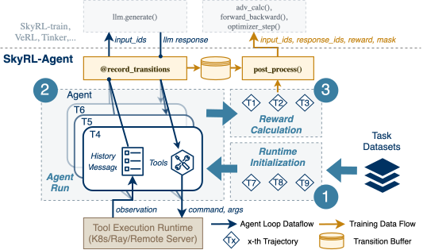
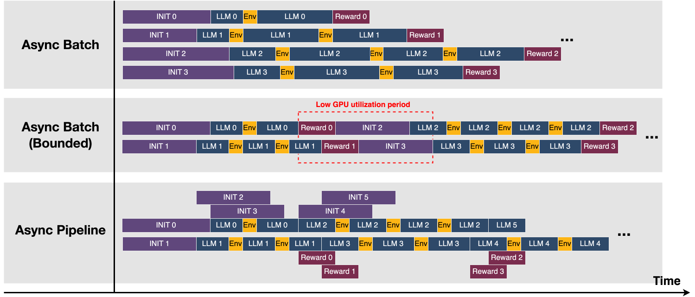
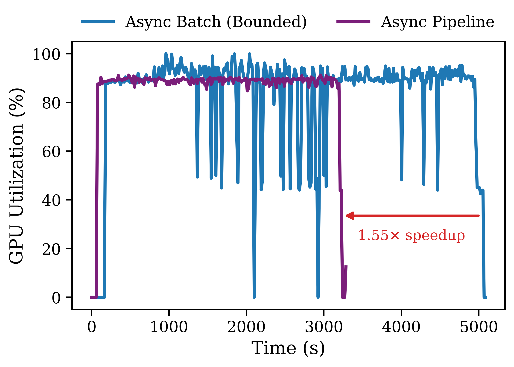
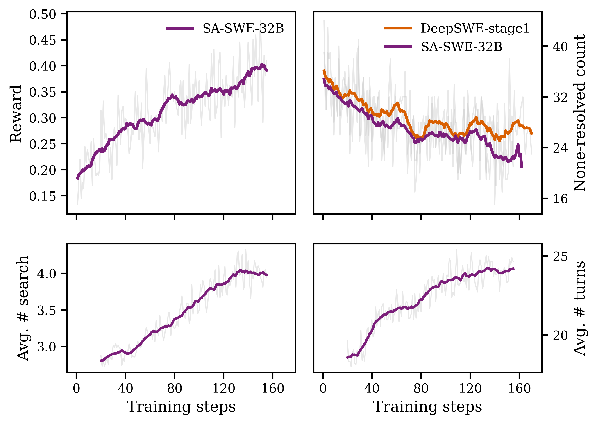

<div align="center">


Training and evaluating modern AI agents with modular tasks, tools, and backends.

[](https://arxiv.org/pdf/2511.16108)
[](https://huggingface.co/NovaSky-AI/SA-SWE-32B)

<br/>

<br/>

</div>

## News 📰✨

- 🚀 Initial public release with SWE, MemAgent (step-wise training), and Web Research examples!

## Why SkyRL-Agent

- Unified interface for agentic tasks and training backends
- Pluggable tools (browser, search, code execution, finish, etc.)
- Efficient and flexible async dispatching strategies
- Works with OpenAI-compatible serving (vLLM/others), VERL, SkyRL-Train, Tinker. Switch the backend with one line configuration!

<p align="center">
  
</p>

## Quickstart

```bash
git clone --recurse-submodules https://github.com/NovaSky-AI/SkyRL.git 
# our working directory
cd skyrl-agent
```

Then head to the `examples/` folder to run tasks (training and inference). Each task’s script/YAML documents its own knobs and environment requirements.

### Optional anonymous web search

Select `parallel_search_engine` in your task's `tools` list to use
[Parallel Search MCP](https://docs.parallel.ai/integrations/mcp/search-mcp) without a search API key:

```yaml
tools: ["parallel_search_engine", "finish"]
```

Existing task defaults and providers stay selected unless you change that list.
Leaving Parallel out of the list makes no Parallel requests. Selecting `search_engine`
or `youcom_search_engine` still requires that provider's key; errors do not switch providers.
The Parallel tool is anonymous only and does not read provider credentials. Anonymous
requests use Parallel's documented server-managed Fast defaults and may be rate limited.

With the SkyRL-Agent dependencies installed, try a registry call from `skyrl-agent/`
without starting an inference server:

```bash
uv run --isolated --frozen python -c 'from skyrl_agent.tools import TOOL_REGISTRY; print(TOOL_REGISTRY["parallel_search_engine"]().call({"query": ["NASA Webb telescope first deep field SMACS 0723"]}))'
```

Results include source URLs and excerpts. The tool uses `https://mcp.parallel.ai/mcp`
and the same `SEARCH_BLOCKLIST_DOMAINS`, `SEARCH_BLOCKLIST_KEYWORDS`, and
`SEARCH_NEGATIVE_FILTERS` controls and leakage-protection defaults as You.com search.
Only web search is exposed; the existing browser tool remains separately selectable.
Search failures are returned as tool errors. Run the focused synthetic checks with
`uv run --isolated --with pytest pytest tests/tools/test_parallel_search_engine.py`.

## Results & Profiling (glimpses)

<p align="center">
  
  &nbsp;&nbsp;
  
</p>

## Roadmap

- [ ] OSWorld Integration
- [ ] Simplify SWE agent training code path
- [ ] More training recipes
- [ ] Evaluation harness unification

## Acknowledgements
Huge thanks to these projects:
- [VERL](https://github.com/volcengine/verl)
- [OpenHands](https://github.com/OpenHands/OpenHands)
- [LocAgent](https://github.com/gersteinlab/LocAgent)
- [R2E-Gym](https://github.com/R2E-Gym/R2E-Gym)
- [Tinker Cookbook](https://github.com/thinking-machines-lab/tinker-cookbook)
- [rLLM](https://github.com/rllm-org/rllm)
- [WebThinker](https://github.com/RUC-NLPIR/WebThinker)
- [WebSailor](https://github.com/Alibaba-NLP/DeepResearch)
- [ARPO](https://github.com/dvlab-research/ARPO)
- [MemAgent](https://github.com/BytedTsinghua-SIA/MemAgent)

## Citation

```bibtex
@article{cao2025skyrl,
  title={SkyRL-Agent: Efficient RL Training for Multi-turn LLM Agent},
  author={Cao, Shiyi and Li, Dacheng and Zhao, Fangzhou and Yuan, Shuo and Hegde, Sumanth R and Chen, Connor and Ruan, Charlie and Griggs, Tyler and Liu, Shu and Tang, Eric and others},
  journal={arXiv preprint arXiv:2511.16108},
  year={2025}
}
```
